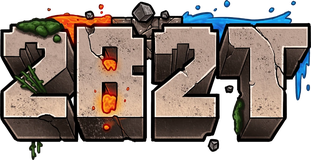

# Based Client

**A clean, fast, fully un-obfuscated Minecraft utility client.**

**[🌐 Website / Download Page](https://yesd3v.github.io/Based/)** · **[📦 Releases](https://github.com/YesD3v/Based/releases)**

---

## What is Based Client?

**Based Client** is a standalone Minecraft **Fabric** utility mod with **158 modules** for combat, movement, visuals and utility. It ships as a single jar — drop it in your `mods` folder and go. No launcher, no bloat, no DRM.

### Features

- ⚔️ **Combat** — Kill Aura, Crystal Aura, Sword Bot and Backstab Bot (timed crits, spacing, smooth aim), Auto City, Auto Totem, Mace, Anti Knockback and more, plus Opsec, a full blatant fight for authorized worlds only
- ✨ **Effects & look** — Radiance (gradient outlines, glow, aura and a glossy Shine), Shaders, PvP Effects, Trails, Elytra Effects, custom Weather and Fog, Atmosphere shader skies, Block Animation and a Based cape
- 🔪 **CS Knife** — Butterfly, Karambit and Katana skins with CS-style draws, inspects, Infinite Spin and a hard catch on every spin
- 🎵 **Spotify HUD & 3D Lyrics** — synced lyrics on your HUD and placed in the world, word by word when the song has word sync
- 🙈 **No Leak** — keeps your visuals, HUD, inventory and scoreboard out of screenshots, screen shares and recordings
- 🌐 **Proxies** — save SOCKS5/HTTP proxies and connect through them from the Multiplayer screen
- 🪟 **HUD** — Liquid Glass, Glow Outline, Keystrokes, Speed Graph, Lyrics Line and your own merged info lines, all in the HUD editor
- 🖼️ **Screens** — your own title screen, splash and loading screen, with shader skies, Liquid Glass menus and a title screen HUD editor
- 🏃 **Movement** — Flight from 0.05x to 50x vanilla speed, No Slow, Elytra Fly, Speed and more
- 🎒 **Quality of life** — Inventory Tweaks, Setting Tips, Name Protect, Fast Break and more
- 🪟 **ImGui interface** — fast menus you can drag, resize and configure on the fly
- 🧑‍🚀 **Accounts & cosmetics** — built-in account handling and cosmetic support
- ⚡ **Lightweight** — one Fabric jar, nothing more

### Works on servers like

  &nbsp;&nbsp;&nbsp;
  &nbsp;&nbsp;&nbsp;
  

Based isn't affiliated with or endorsed by these servers; their names and logos belong to their owners. Check each server's rules before you play.

## 🔓 Not obfuscated — because YesDev is goated

A lot of clients hand you a scrambled, obfuscated jar and tell you to just trust it. **Based is not one of them.**

The build in [Releases](https://github.com/YesD3v/Based/releases) is shipped **clean and readable** — real class names, real packages, no ProGuard wall, no hidden payloads. Decompile it, read it, learn from it. **What you run is exactly what you see.**

## Installation

1. **Install Fabric** — [Fabric Loader](https://fabricmc.net/use/installer/) (≥ 0.16) + [Fabric API](https://modrinth.com/mod/fabric-api) for Minecraft **1.21.11**, on **Java 21+**.
2. **Download** the latest jar from the [Releases page](https://github.com/YesD3v/Based/releases/latest).
3. **Drop** the jar into your `.minecraft/mods` folder.
4. **Launch** Minecraft on the Fabric profile. That's it — you're based.

## Download

👉 **[Grab the latest release](https://github.com/YesD3v/Based/releases/latest)**

> Current build: **v2.0** · Minecraft **1.21.11** · Fabric

## License

Released under **GPL-3.0**. See [`LICENSE`](LICENSE).

crafted by <b>YesDev</b> · goated 👑

